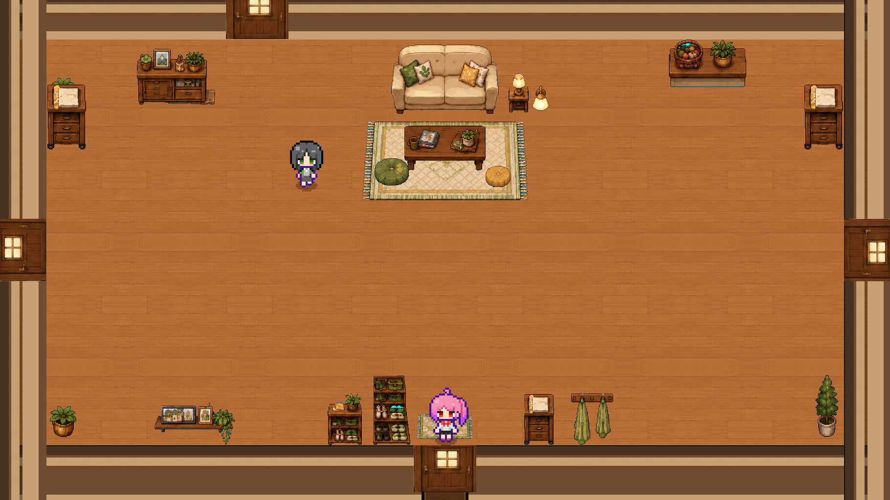

# Student Growth

A 2D pixel-art student-life simulation RPG built with Unity 6.

Instead of a menu-only simulator, the game is driven by an explorable map: you walk around
home, school, shop and park, interact with furniture and NPCs, spend limited time slots on
activities, and build a deck for turn-based card battles at the end of each stage.



> Early-stage project. The core loop is playable; content is still being added.

---

## What it is

A student-growth RPG: study, rest, socialize and take on challenges across stages of school
life. Stats, stress and mood constrain what you can do each day; cards and items carry over
into stage-end boss fights.

The core loop:

```
Enter a location
  → move around the map
  → interact with furniture / NPCs / doors
  → execute an activity (consumes time and stamina)
  → gain stats, cards, items
  → advance the time slot
  → stage-end boss battle
  → next stage
```

---

## Current status

Work in progress, at the V0.2 "RPG map interaction" milestone — the goal being to make the
home map a complete playable loop before replicating it to the other locations.

| Area | State |
| --- | --- |
| Player movement + 4-direction animation | Done |
| Tilemap collision, walls, furniture | Done |
| Facing-based interaction + prompt UI | Done |
| Room-to-room doors (E key) | Done |
| Activity system (time / stamina / stat cost) | Done |
| Status HUD | Done |
| Card battle | Partial |
| Locations | Home (4 rooms), school, shop, library, park, club, stage hub |
| Save / load | Partial |
| Endings, NPC affinity, quests | Not started |

Content currently in the project: **31 cards**, **18 activity data assets**, 13 scenes in
Build Settings, **197 C# files / ~40k lines**, **43 test files**.

---

## Running it

Requirements:

- **Unity 6** — the project pins `6000.4.6f1` (see `ProjectSettings/ProjectVersion.txt`)
- The four UPM packages below are pulled from Git; they resolve automatically on first open

```bash
git clone https://github.com/qwq1158254109-afk/game.git
```

Open the folder in Unity Hub, let it import, then open
`Assets/Scenes/StudentGrowth/MainMenuScene.unity` and press Play.

> **Note on Play mode:** entering Play loads the *first* scene in Build Settings
> (`MainMenuScene`), not whichever scene is currently open in the editor. To test a room
> directly, either navigate there in-game or let a runtime probe load it via `SceneManager`.

### Dependencies

| Package | Source |
| --- | --- |
| [LitMotion](https://github.com/annulusgames/LitMotion) | GitHub UPM |
| [UIEffect](https://github.com/mob-sakai/UIEffect) | GitHub UPM |
| [NavMeshPlus](https://github.com/h8man/NavMeshPlus) | GitHub UPM |
| [Yarn Spinner](https://github.com/YarnSpinnerTool/YarnSpinner-Unity) | GitHub UPM |

These are GitHub UPM packages, so they do **not** appear in Package Manager under
"My Assets" (Asset Store only) or "Unity Registry" — look under **Packages: In Project**.

If UPM fetches fail due to network resets, `Tools/install_git_mirrors.sh` rebuilds a local
mirror set.

---

## Project layout

```
Assets/
├── Art/          pixel art (characters, tilesets, UI, generated room backgrounds)
├── Data/         ScriptableObject activity data
├── Editor/       scene builders (rooms are generated, not hand-edited)
├── Prefabs/      player, UI, map, battle prefabs
├── Resources/    runtime-loaded UI themes, card pools, cards
├── Scenes/       MainMenu, Home (4 rooms), School, Shop, Library, Park, Club, StageHub
├── Scripts/      runtime code (see below)
└── Tests/        EditMode + PlayMode tests
Tools/            Python toolchain: art generation, geometry validation, log analysis
Docs/             design notes and troubleshooting records
```

Runtime code is split into `Core`, `Student`, `TimeSystem`, `Map`, `Interaction`,
`Activity`, `Battle`, `Cards`, `Inventory`, `NPC`, `UI`, `Save`, `Utils`.

---

## Design notes

A few conventions worth knowing before contributing:

- **UI / Controller / Data are separated.** UI views only display and forward input;
  controllers own flow and rules; data lives in ScriptableObjects or static config.
- **The home room scenes are generated.** `HomeRoomsBuilder.cs` rebuilds all four rooms from
  code — hand edits to those scenes are overwritten on the next rebuild. Furniture placement
  lives in `DecorSpec(x, y)` there.
- **Room shells are baked from a Python toolchain.** `Tools/make_shell_tex.py` and
  `Tools/make_rooms.py` produce the room background PNGs; `Tools/verify_shell.py` checks
  that door openings line up with the wall bands.
- **Interaction is data-driven.** Anything interactable gets a `MapInteractionTarget` +
  `MapInteractionPoint`; `FullscreenMapSceneController` collects them at runtime, so no
  per-object scripts are needed.

`AGENTS.md` documents the project's engineering conventions and a list of environment
gotchas that have cost real debugging time (MCP connection behaviour, compile-error log
locations, Play mode scene loading, and more).

---

## Tools

The `Tools/` directory holds Python scripts used during development. They are not required
to run the game:

| Script | Purpose |
| --- | --- |
| `make_shell_tex.py` | Generate wall/floor material tiles from a reference image |
| `make_rooms.py` | Compose the four room background PNGs |
| `verify_shell.py` | Validate door-hole alignment and colour-count thresholds |
| `apply_room_thickness.py` | Batch-rewrite wall geometry with a hit-count guard |
| `extract_compile_errors.py` | Pull compile errors out of Unity's tundra log |
| `probe_*.py` | One-off measurement / provenance probes |

---

## Testing

43 test files under `Assets/Tests/`, covering scene finalization, battle flow, activity
resolution and UI behaviour. Run them from Unity's Test Runner (EditMode works; PlayMode
tests are currently unreliable in this environment).

---

## License

[MIT](LICENSE)

---

## Contributing

Issues and PRs are welcome. Since the project is early-stage, the most useful contributions
right now are bug reports with reproduction steps and feedback on the core loop. If you are
changing room layout or scene structure, read `AGENTS.md` first — several parts of the
scenes are code-generated and will be overwritten.
