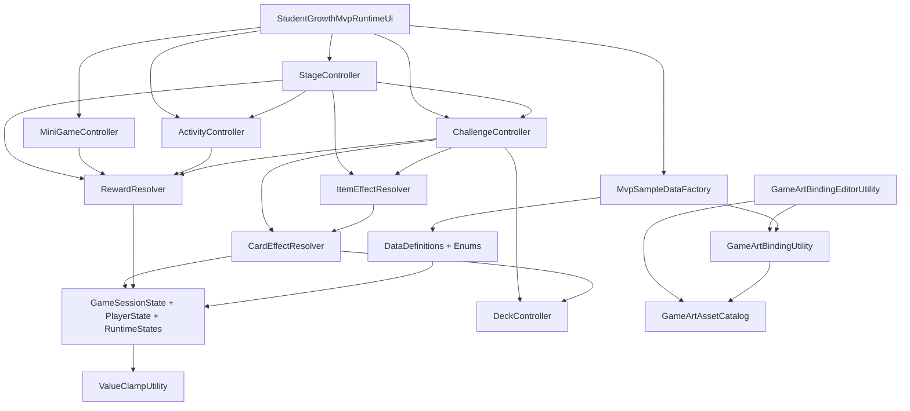

# StudentGrowth 脚本代码说明

生成日期：2026-05-19

本文档基于项目内 `Assets/**/*.cs` 脚本生成，范围包含：

- `Assets/Scripts/StudentGrowth` 下的运行时代码。
- `Assets/Scripts/StudentGrowth/Editor` 下的编辑器工具代码。
- `Assets/Tests/EditMode` 下的 EditMode 测试代码。

不包含 `Library`、`Temp`、`Packages` 包缓存中的 Unity 或第三方源码，也不包含 `.asmdef`、`.meta`、场景和资源文件。

## 项目脚本结构

当前代码可以按职责分为五层：

1. 数据定义层：`DataDefinitions.cs`、`Enums.cs` 定义 ScriptableObject 数据、奖励、卡牌效果、事件条件和各种枚举。
2. 运行状态层：`PlayerState.cs`、`GameSessionState.cs`、`RuntimeStates.cs` 保存玩家、阶段、战斗、卡组和道具背包的运行时状态。
3. 规则解析层：`RewardResolver.cs`、`CardEffectResolver.cs`、`ItemEffectResolver.cs`、`EventConditionResolver.cs` 负责把数据配置转成状态变化。
4. 流程控制层：`ActivityController.cs`、`MiniGameController.cs`、`DeckController.cs`、`ChallengeController.cs`、`StageController.cs` 负责活动、小游戏、卡组、挑战和阶段流程。
5. 展示和工具层：`MvpSampleDataFactory.cs`、`StudentGrowthMvpRuntimeUi.cs`、`StudentGrowthRuntimeArtPreview.cs`、`GameArtAssetCatalog.cs`、`GameArtBindingUtility.cs`、`Editor/GameArtBindingEditorUtility.cs` 负责样例数据、运行时 UI、美术路径和编辑器绑定。

## 推荐阅读顺序

1. 先看 `Enums.cs` 和 `DataDefinitions.cs`，理解项目的数据模型。
2. 再看 `PlayerState.cs`、`RuntimeStates.cs`、`GameSessionState.cs`，理解状态保存位置。
3. 接着看 `RewardResolver.cs`、`CardEffectResolver.cs`、`ItemEffectResolver.cs`，理解奖励、卡牌和道具如何改变状态。
4. 然后看 `ActivityController.cs`、`MiniGameController.cs`、`DeckController.cs`、`ChallengeController.cs`、`StageController.cs`，理解完整玩法流程。
5. 最后看 UI、样例数据和测试脚本。

## 运行时代码

### `Assets/Scripts/StudentGrowth/Enums.cs`

这个文件集中定义项目核心枚举，避免各系统使用散落的字符串或数字判断类型。

包含的枚举：

- `PlayerStatKey`：玩家属性键，包括语文、数学、英语、精力、最大精力、压力、心情、亲子关系、社交、兴趣、自信、自主和金钱。
- `ActivityType`：阶段活动类型，包括事件、卡牌战斗、小游戏、休息、商店和训练。
- `CardType`：卡牌类型，包括学习、休息、社交、家庭、兴趣、特质和状态。
- `CardRarity`：卡牌稀有度，包括普通、非普通和稀有。
- `CardEffectType`：卡牌效果类型，例如增加挑战进度、改变玩家属性、抽牌、获得精力、减少压力、添加状态卡等。
- `MiniGameType`：小游戏类型，例如记忆、计时、选择问答、反应和简单谜题。
- `ItemType`：道具类型，包括消耗品、被动道具和阶段限定道具。
- `ItemTriggerTiming`：道具触发时机，包括获得时、阶段开始、战斗开始、打出卡牌、Boss 开始、使用时、阶段结束。
- `RewardType`：奖励类型，包括加卡、升级卡、删卡、改变玩家属性、加钱、减压力、加道具、解锁活动、解锁阶段和增加阶段时间。
- `ComparisonType`：事件条件比较方式，包括大于等于、小于等于、等于和不等于。

设计作用：

- 让 ScriptableObject 数据和运行时逻辑使用相同的类型定义。
- 让 `switch` 分支可读，并在未来扩展类型时能直接定位需要补充的解析逻辑。
- 减少拼写错误导致的运行时问题。

维护注意：

- 新增枚举值后，需要检查对应解析器是否处理，例如新增 `RewardType` 后要检查 `RewardResolver.ApplyReward`。
- 新增 `CardEffectType` 后要检查 `CardEffectResolver.ApplyEffect` 和 UI 的 `BuildEffectSummary`。

### `Assets/Scripts/StudentGrowth/DataDefinitions.cs`

这个文件定义项目的核心配置数据。大多数主要数据继承自 `ScriptableObject`，方便在 Unity Inspector 中创建和配置。

主要类型：

- `StageData`：阶段数据。
- `ActivityData`：阶段内可选活动数据。
- `CardData`：卡牌数据。
- `CardEffectData`：卡牌效果配置。
- `ChallengeData`：挑战或 Boss 数据。
- `ChallengeIntentData`：挑战中某回合触发的意图或压力事件。
- `MiniGameData`：小游戏配置。
- `ItemData`：道具配置。
- `RewardData`：通用奖励配置。
- `GameEventData`：事件配置。
- `EventChoiceData`：事件选项。
- `EventConditionData`：事件或活动出现条件。
- `EndingData`：结局配置。

关键设计：

- `CreateAssetMenu` 让 `StageData`、`ActivityData`、`CardData`、`ChallengeData`、`MiniGameData`、`ItemData`、`GameEventData`、`EndingData` 可以从 Unity 的 Create 菜单创建。
- 多个数据类都有 `Sprite` 字段和 `imagePath` 字段。`Sprite` 用于 Inspector 直接引用，`imagePath` 用于运行时代码按路径加载图片。
- `RewardData` 是跨系统的通用奖励结构，活动、挑战、小游戏、事件选项都可以使用它。
- `CardEffectData` 是卡牌和道具效果的共享结构，道具通过复用卡牌效果解析器来减少重复逻辑。

各类型说明：

- `StageData`
  - 保存阶段 ID、显示名、描述、背景、图标、时间限制、可选活动、Boss 挑战、进入奖励、通关奖励、下一阶段 ID 和是否最终阶段。
  - 被 `StageController` 用于启动阶段、筛选活动、进入 Boss 和推进下一阶段。

- `ActivityData`
  - 保存活动 ID、显示名、描述、活动类型、图片、时间消耗、关联挑战、关联事件、关联小游戏、固定奖励、可能奖励和出现条件。
  - 被 `ActivityController` 和 `StageController` 使用。

- `CardData`
  - 保存卡牌 ID、显示名、类型、稀有度、费用、描述、图片、效果列表、标签、是否使用后移除以及升级版本。
  - 被 `DeckController`、`CardEffectResolver`、`ChallengeController` 和 UI 使用。

- `ChallengeData`
  - 保存挑战目标进度、最大回合数、起始精力、起始手牌数、回合意图、成功奖励、失败奖励、Boss 成功奖励、Boss 失败奖励等。
  - 被 `ChallengeController` 用于完整卡牌挑战流程。

- `ItemData`
  - 保存道具 ID、显示名、类型、描述、图标、效果列表、触发时机、是否使用后消耗、是否可在战斗中使用、是否可在阶段界面使用。
  - 被 `ItemEffectResolver` 和 UI 使用。

维护注意：

- 这些字段大多是 `public`，Unity 会序列化它们。重命名、改类型或改可见性会影响已有资源引用。
- 未来如果把 `imagePath` 替换成 Addressables 或 Resources，需要同步修改 `GameArtBindingUtility`、`GameArtBindingEditorUtility` 和运行时 UI 的加载逻辑。

### `Assets/Scripts/StudentGrowth/PlayerState.cs`

这个文件定义玩家的长期属性状态。

主要字段：

- 学科属性：`chinese`、`math`、`english`。
- 当前资源和压力：`energy`、`maxEnergy`、`pressure`、`mood`。
- 成长关系属性：`parentRelation`、`social`、`interest`、`confidence`、`autonomy`。
- 经济属性：`money`。

主要方法：

- `PlayerState()`：构造时调用 `ResetToDefaults`，确保新状态有默认值。
- `ResetToDefaults()`：设置默认属性，并调用 `ClampAll` 做边界修正。
- `GetStat(PlayerStatKey key)`：按枚举读取对应属性。
- `SetStat(PlayerStatKey key, int value)`：按枚举写入属性，然后统一夹取边界。
- `AddStat(PlayerStatKey key, int delta)`：在现有值基础上加减。
- `ClampAll()`：调用 `ValueClampUtility.ClampPlayerState`。

默认值示例：

- 语文、数学、英语默认 35。
- 精力和最大精力默认 60。
- 压力默认 20。
- 心情默认 60。
- 金钱默认 100。

设计作用：

- 所有属性修改都推荐经过 `SetStat` 或 `AddStat`，这样能自动保持边界合法。
- `RewardResolver`、`CardEffectResolver`、`MiniGameController`、`EventConditionResolver` 都依赖这个类。

维护注意：

- 新增玩家属性时，需要同步修改 `PlayerStatKey`、`GetStat`、`SetStat`、`ResetToDefaults`、`ValueClampUtility.ClampPlayerState` 和 UI 显示。
- 如果直接改 public 字段，不会自动夹取，除非后续调用 `ClampAll`。

### `Assets/Scripts/StudentGrowth/ValueClampUtility.cs`

这个文件集中处理玩家属性边界。

常量：

- `StatMin = 0`。
- `StatMax = 100`。
- `MaxEnergyMin = 1`。
- `MoneyMax = 9999`。

主要方法：

- `ClampPlayerState(PlayerState playerState)`：对整个玩家状态做边界限制。
- `ClampPercentStat(int value)`：把百分比类属性限制在 `0..100`。

夹取规则：

- 学科、压力、心情、亲子、社交、兴趣、自信、自主限制在 `0..100`。
- `maxEnergy` 限制在 `1..100`。
- `energy` 限制在 `0..maxEnergy`。
- `money` 限制在 `0..9999`。

设计作用：

- 把所有边界规则集中到一个位置，避免各系统各自实现。
- `PlayerState.ClampAll` 和 `GameSessionState.ClampAll` 都依赖它。

维护注意：

- 如果未来某项属性允许超过 100，需要在这里调整，而不是在奖励或卡牌解析器中单独绕过。

### `Assets/Scripts/StudentGrowth/RuntimeStates.cs`

这个文件定义运行中会变化的状态类，与 `DataDefinitions.cs` 中的配置数据区分开。

主要类型：

- `StageState`：当前阶段运行状态。
- `ChallengeRuntimeState`：当前挑战运行状态。
- `DeckState`：卡组和战斗牌堆状态。
- `ItemInventory`：玩家持有道具状态。

`StageState` 字段：

- `currentStage`：当前阶段配置。
- `remainingTime`：当前阶段剩余时间。
- `bossUnlocked`：Boss 是否解锁。
- `bossDefeated`：Boss 是否击败。
- `clearedStageCount`：已通关阶段数。
- `defeatedBossCount`：已击败 Boss 数。

`ChallengeRuntimeState` 字段：

- `data`：当前挑战配置。
- `currentProgress`：当前挑战进度。
- `currentTurn`：当前回合。
- `currentEnergy`：当前挑战内可用精力。
- `isComplete`：挑战是否结束。
- `isSuccess`：挑战是否成功。

`DeckState` 方法：

- `AddCardToMasterDeck`：把卡加入主卡组，忽略 null。
- `RemoveCardFromMasterDeck`：从主卡组移除指定卡。
- `UpgradeCard`：用升级版替换主卡组中的原卡。
- `ClearBattlePiles`：清空抽牌堆、手牌、弃牌堆和消耗堆。

`ItemInventory` 方法：

- `AddItem`：加入道具，忽略 null。
- `RemoveItem`：移除道具。
- `ContainsItem`：检查是否拥有道具。
- `ClearStageOnlyItems`：清除阶段限定道具。

设计作用：

- 保持运行时状态可序列化、结构简单。
- 给 Controller 和 Resolver 提供共享状态对象。

维护注意：

- `DeckState.masterDeck` 同时表示长期主卡组，也会在 `DeckController.InitializeBattleDeck` 中被重置为战斗源卡组拷贝。这个设计当前测试覆盖了主卡组保留，但未来如果要区分长期卡组和战斗副本，需要拆分职责。

### `Assets/Scripts/StudentGrowth/GameSessionState.cs`

这个文件定义一局游戏的总状态容器。

主要字段：

- `playerState`：玩家属性。
- `stageState`：阶段状态。
- `deckState`：卡组状态。
- `itemInventory`：道具背包。
- `unlockedActivities`：已解锁活动列表。
- `unlockedStages`：已解锁阶段列表。
- `currentEnding`：当前结局数据。
- `endingReached`：是否到达结局。

主要方法：

- `ClampAll()`：对玩家状态和阶段剩余时间做合法性修正。

设计作用：

- 作为所有控制器和解析器之间共享的根状态对象。
- `StageController`、`ChallengeController`、`ActivityController`、`RewardResolver`、`ItemEffectResolver` 都通过它读写游戏状态。

维护注意：

- 如果将来增加存档系统，这个类很可能成为存档根对象。
- 如果新增状态字段，应同步考虑初始化、清理、存档和测试。

### `Assets/Scripts/StudentGrowth/RewardResolver.cs`

这个文件负责把 `RewardData` 转换为实际状态变化。

主要方法：

- `ApplyReward(RewardData reward, GameSessionState sessionState)`：应用单个奖励。
- `ApplyRewards(IEnumerable<RewardData> rewards, GameSessionState sessionState)`：顺序应用一组奖励。

支持的奖励：

- `AddCard`：加入主卡组。
- `UpgradeCard`：把卡替换为 `upgradedVersion`。
- `RemoveCard`：从主卡组移除卡。
- `AddPlayerStat`：增加指定玩家属性。
- `ReducePlayerStat`：减少指定玩家属性。
- `AddMoney`：增加金钱。
- `ReducePressure`：减少压力。
- `IncreaseMaxEnergy`：增加最大精力。
- `AddItem`：加入道具。
- `RemoveItem`：移除道具。
- `UnlockActivity`：加入解锁活动列表，并避免重复。
- `UnlockStage`：加入解锁阶段列表，并避免重复。
- `AddStageTime`：增加阶段剩余时间，并保证不低于 0。

边界处理：

- `reward == null` 时直接返回。
- `sessionState == null` 时抛出 `ArgumentNullException`。
- 应用奖励后调用 `sessionState.ClampAll()`。

设计作用：

- 活动奖励、挑战奖励、小游戏奖励、事件奖励都可以统一走这个入口。
- 把奖励处理集中在一个文件，避免流程控制器直接修改过多状态细节。

维护注意：

- 新增 `RewardType` 必须在这里补充分支。
- 当前 `UpgradeCard` 只处理 `reward.card.upgradedVersion`，没有使用单独字段表示升级目标。

### `Assets/Scripts/StudentGrowth/CardEffectResolver.cs`

这个文件负责解析卡牌效果，并修改玩家状态、挑战状态或牌堆状态。

主要方法：

- `ApplyCard(CardData card, GameSessionState sessionState, ChallengeRuntimeState challengeState, DeckController deckController = null)`：应用一张卡的全部效果。
- `ApplyEffect(CardEffectData effect, GameSessionState sessionState, ChallengeRuntimeState challengeState, DeckController deckController = null)`：应用单个效果。

已实现效果：

- `AddChallengeProgress`：增加挑战进度，进度不低于 0。
- `AddSubjectProgress` 和 `AddPlayerStat`：增加玩家指定属性。
- `ReducePlayerStat`：减少玩家指定属性。
- `DrawCards`：通过 `DeckController.DrawCards` 抽牌。
- `GainEnergy`：增加玩家精力。
- `LoseEnergy`：减少玩家精力。
- `ReducePressure`：减少压力。
- `AddPressure`：增加压力。

暂未实现但已占位的效果：

- `AddTemporaryBuff`。
- `AddStatusCardToDrawPile`。
- `AddStatusCardToDiscardPile`。
- `ExhaustCard`。
- `ModifyNextCardEffect`。

边界处理：

- `card == null` 或 `effect == null` 时直接返回。
- `sessionState == null` 时抛出异常。
- `challengeState == null` 时，挑战进度类效果会被忽略。
- 每次效果处理后都会调用 `sessionState.ClampAll()`。

设计作用：

- 卡牌和道具共用这一套效果结构，道具效果由 `ItemEffectResolver` 转交给它执行。
- `ChallengeController.PlayCard` 是主要调用方。

维护注意：

- 当前挑战内精力扣除在 `ChallengeController.PlayCard` 中完成，不在这里处理卡牌费用。
- 对牌堆有影响的效果需要依赖 `DeckController`，没有传入时会静默跳过抽牌。

### `Assets/Scripts/StudentGrowth/ItemEffectResolver.cs`

这个文件负责道具使用、被动道具触发和阶段限定道具清理。

主要方法：

- `UseItem(...)`：主动使用道具。
- `ApplyPassiveItems(...)`：按触发时机应用所有被动道具。
- `ApplyItemEffects(...)`：检查触发时机并执行道具效果。
- `ClearStageOnlyItems(GameSessionState sessionState)`：移除阶段限定道具，并返回移除数量。

`UseItem` 流程：

1. 调用 `ValidateItemUse` 检查道具是否存在、是否拥有、是否允许在当前场景使用。
2. 用 `ApplyItemEffects` 执行 `OnUse` 效果。
3. 如果道具是消耗品或 `consumedOnUse` 为 true，从背包移除。
4. 返回 `ItemUseResult`。

`ApplyPassiveItems` 流程：

1. 复制一份当前背包列表，避免遍历时被修改。
2. 只处理 `ItemType.Passive`。
3. 触发时机匹配才应用效果。
4. 返回成功触发的被动道具数量。

`ItemUseResult`：

- `success`：是否成功。
- `consumed`：是否被消耗。
- `appliedEffectCount`：应用的效果数量。
- `message`：失败或说明信息。

设计作用：

- 把道具系统和卡牌效果系统连接起来。
- 允许同一套 `CardEffectData` 同时用于卡牌和道具。

维护注意：

- `ApplyItemEffects` 要求 `item.triggerTiming == timing`，所以一个道具目前只能有一个触发时机。
- 如果未来道具需要多个触发时机，需要改字段结构或增加列表。

### `Assets/Scripts/StudentGrowth/EventConditionResolver.cs`

这个文件负责判断事件条件和活动出现条件。

主要方法：

- `AreConditionsMet(IEnumerable<EventConditionData> conditions, PlayerState playerState)`：判断一组条件是否全部满足。
- `IsConditionMet(EventConditionData condition, PlayerState playerState)`：判断单个条件。

比较逻辑：

- `GreaterOrEqual`：当前属性大于等于配置值。
- `LessOrEqual`：当前属性小于等于配置值。
- `Equal`：当前属性等于配置值。
- `NotEqual`：当前属性不等于配置值。

边界处理：

- 条件列表为 null 时返回 true。
- 单个条件为 null 或玩家状态为 null 时返回 true。

设计作用：

- `ActivityController.CanActivityAppear` 用它判断活动是否显示。
- `ActivityController.ResolveEventActivity` 用它选择第一个满足条件的事件选项。
- `StageController.GetAvailableActivities` 用它筛选当前阶段可用活动。

维护注意：

- 当前条件之间是全部满足的 AND 关系，没有 OR 组合。
- `playerState == null` 返回 true 是宽松设计，未来如果要更严格，可以改为 false，但会影响现有逻辑。

### `Assets/Scripts/StudentGrowth/DeckController.cs`

这个文件负责战斗中的牌堆操作，是一个 `MonoBehaviour`。

主要字段：

- `deckState`：当前卡组和战斗牌堆状态。

主要方法：

- `SetDeckState`：设置外部传入的牌堆状态，null 时创建新状态。
- `InitializeBattleDeck`：从主卡组创建本次战斗抽牌堆，并清空战斗牌堆。
- `ShuffleDrawPile`：洗抽牌堆。
- `DrawCards`：从抽牌堆移动卡牌到手牌，抽牌堆空时会把弃牌堆洗回抽牌堆。
- `PlayCard`：从手牌移除卡牌，根据 `exhaustAfterUse` 放入消耗堆或弃牌堆。
- `DiscardHand`：把全部手牌放入弃牌堆。
- `ReshuffleDiscardIntoDrawPile`：把弃牌堆洗回抽牌堆。
- `AddCardToMasterDeck`、`RemoveCardFromMasterDeck`、`UpgradeCard`：对主卡组的简单转发。

随机性：

- 洗牌使用 `UnityEngine.Random.Range`。

设计作用：

- `ChallengeController` 调用它完成开局抽牌、出牌、回合结束弃牌和重新抽牌。
- `CardEffectResolver` 的抽牌效果也依赖它。

维护注意：

- `InitializeBattleDeck` 会清空 `deckState.masterDeck` 后再添加源卡组。当前逻辑等价于重建主卡组副本。
- 如果需要可复现测试，洗牌随机性可能需要注入随机源。

### `Assets/Scripts/StudentGrowth/ChallengeController.cs`

这个文件负责一次卡牌挑战或 Boss 战流程，是一个 `MonoBehaviour`。

主要字段：

- `sessionState`：共享游戏状态。
- `runtimeState`：当前挑战状态。
- `deckController`：牌堆控制器。
- `cardEffectResolver`、`itemEffectResolver`、`rewardResolver`：内部规则解析器。

主要方法：

- `SetSessionState`：设置共享状态，并同步给 `deckController`。
- `StartChallenge`：初始化挑战状态、初始化战斗卡组、触发被动道具、抽起手牌并应用第一回合意图。
- `CanPlayCard`：检查卡是否在手牌中、挑战未结束且精力足够。
- `PlayCard`：扣除费用、应用卡牌效果、移动卡牌到弃牌或消耗堆、检查是否完成。
- `EndTurn`：检查完成状态、判断最大回合失败、弃牌、进入下一回合、重置回合精力、抽牌、应用回合意图。
- `ApplyTurnIntent`：执行当前回合匹配的挑战意图效果。
- `CompleteChallenge`：标记挑战结束，并根据普通挑战或 Boss 挑战应用奖励。

挑战完成规则：

- `currentProgress >= targetProgress` 时成功。
- 回合结束时如果 `currentTurn >= maxTurns` 且未达成目标，则失败。
- Boss 挑战使用 `bossClearRewards` 或 `bossFailureRewards`。
- 普通挑战使用 `successRewards` 或 `failureRewards`。

设计作用：

- 串联卡牌、牌堆、道具、挑战意图和奖励。
- `StageController.StartBoss` 会通过它启动阶段 Boss。

维护注意：

- `EnsureDeckController` 会自动在同一 GameObject 上查找或添加 `DeckController`。
- `runtimeState.currentEnergy` 是挑战内精力，不同于 `PlayerState.energy`。
- `CompleteChallenge` 会应用奖励；`StageController.CompleteBoss` 有逻辑避免重复应用 Boss 奖励。

### `Assets/Scripts/StudentGrowth/ActivityController.cs`

这个文件负责解析阶段活动，是一个 `MonoBehaviour`。

主要字段：

- `sessionState`：活动判断和事件选项判断所用的共享状态。

主要方法：

- `SetSessionState`：设置共享状态，null 时创建新状态。
- `ResolveActivity`：根据活动类型生成 `ActivityResult`。
- `CanActivityAppear`：根据活动出现条件判断活动是否可显示。

活动解析逻辑：

- 所有活动都会先加入 `fixedRewards`。
- `Event`：进入 `ResolveEventActivity`，选择第一个满足条件的事件选项，并加入该选项奖励。
- `CardBattle`：只返回准备信息。
- `MiniGame`：使用占位逻辑，默认按成功处理并加入小游戏成功奖励。
- `Rest`、`Shop`、`Training`：返回对应说明，奖励来自固定奖励。

`ActivityResult`：

- 记录活动数据、活动类型、成功状态、关联挑战、关联事件、选中的事件选项、关联小游戏、奖励列表和消息。

设计作用：

- 负责把活动配置转换成可被 `StageController.CompleteActivity` 应用的结果。
- 当前 `MiniGame` 在真实 UI 流程中由 `StudentGrowthMvpRuntimeUi.OnActivityClicked` 单独调用 `MiniGameController`，而这里保留了一个占位成功解析。

维护注意：

- 如果活动类型扩展，需要在 `ResolveActivity` 中增加分支。
- `possibleRewards` 当前未使用。

### `Assets/Scripts/StudentGrowth/MiniGameController.cs`

这个文件负责小游戏结果判定，是一个 `MonoBehaviour`。

主要方法：

- `ResolveMiniGame(MiniGameData data, PlayerState playerState, System.Random random)`：计算成功率，使用随机数判定成功或失败，并返回对应奖励。
- `CalculateSuccessChance(MiniGameData data, PlayerState playerState)`：根据玩家属性和小游戏难度计算成功率。

成功率公式：

- 基础值为 50。
- 主属性加成：`playerState.GetStat(data.primaryStat) / 2`。
- 心情加成：`(mood - 50) / 4`。
- 压力惩罚：`pressure / 5`。
- 难度惩罚：`difficulty * 5`。
- 最终限制在 `15..95`。

`MiniGameResult`：

- `success`：是否成功。
- `successChance`：本次成功率。
- `rewards`：成功或失败对应奖励列表。

设计作用：

- 用可测试的独立逻辑处理小游戏成功率。
- `random` 可传入，方便测试中使用固定随机数。

维护注意：

- 当前没有按不同 `MiniGameType` 做差异化规则。
- 奖励只返回，不直接应用，需要上层用 `RewardResolver` 或 `StageController.CompleteActivity` 处理。

### `Assets/Scripts/StudentGrowth/StageController.cs`

这个文件负责阶段流程，是一个 `MonoBehaviour`。

主要字段：

- `sessionState`：共享游戏状态。
- `stageSequence`：阶段顺序。
- `challengeController`：Boss 挑战控制器。
- `rewardResolver`：奖励解析器。
- `itemEffectResolver`：用于阶段切换时清理阶段限定道具。
- `availableActivitiesBuffer`：复用的活动筛选缓存。

主要方法：

- `SetSessionState`：设置共享状态，并同步给挑战控制器。
- `StartStage`：设置当前阶段、剩余时间、Boss 状态，绑定阶段图片路径并应用进入阶段奖励。
- `GetAvailableActivities`：返回当前阶段满足出现条件的活动。
- `CompleteActivity`：应用活动结果奖励或活动固定奖励，扣除活动时间，时间耗尽时解锁 Boss。
- `ShouldStartBoss`：判断当前是否可以进入 Boss。
- `StartBoss`：启动当前阶段 Boss。
- `CompleteBoss`：处理 Boss 结果，应用奖励、计数、通关奖励和最终结局标记。
- `MoveToNextStage`：按 `nextStageId` 进入下一阶段，或进入结局。

阶段推进规则：

- 阶段开始时 `remainingTime = max(0, timeLimit)`。
- 完成活动会扣除 `timeCost`，最低为 0。
- 剩余时间为 0 时 Boss 解锁。
- Boss 胜利时 `defeatedBossCount` 和 `clearedStageCount` 增加。
- 最终阶段完成后 `endingReached = true`。
- 进入下一阶段前会清理 `StageOnly` 道具。

设计作用：

- 串联阶段、活动、Boss、奖励、道具清理和结局。
- 是当前 MVP 流程的核心控制器。

维护注意：

- `CompleteBoss` 中包含避免 Boss 奖励重复应用的判断，因为 `ChallengeController.CompleteChallenge` 也可能已经应用 Boss 奖励。
- `FindStageById` 使用字符串 ID 查找阶段，阶段 ID 需要保持唯一。

### `Assets/Scripts/StudentGrowth/MvpSampleDataFactory.cs`

这个文件用代码生成一套 MVP 示例数据。

主要方法：

- `CreateSessionWithStarterDeck()`：创建新会话并加入初始卡组。
- `CreateThreeStageSequence()`：创建三阶段流程，包括阶段、Boss、活动、小游戏和事件。

内部辅助方法：

- `CreateStage`：创建阶段，并绑定已知图片路径。
- `CreateBoss`：创建 Boss 挑战，并设置 Boss 奖励。
- `CreateTrainingActivity`：创建训练活动。
- `CreateRestActivity`：创建休息活动。
- `CreateMiniGameActivity`：创建小游戏活动和对应 `MiniGameData`。
- `CreateEventActivity`：创建事件活动和默认事件选项。
- `CreateProgressCard`：创建增加挑战进度的学习卡。
- `CreateRestCard`：创建回复精力、降低压力的休息卡。
- `CreateStatReward`：创建加属性奖励。

样例流程：

- 第一阶段：适应新学期。
- 第二阶段：月考压力。
- 第三阶段：期末冲刺。

设计作用：

- 不依赖已创建的 ScriptableObject 资源，运行时直接构造一套可玩的示例数据。
- `StudentGrowthMvpRuntimeUi` 用它快速启动 MVP 演示。
- 测试也用它验证阶段推进。

维护注意：

- 这里创建的是运行时临时对象，不会保存为资源。
- 如果正式项目改为资源驱动，这个类可以作为 demo 或测试数据保留。

### `Assets/Scripts/StudentGrowth/GameArtAssetCatalog.cs`

这个文件集中登记项目美术资源路径。

主要常量：

- `CardReferenceRoot`：卡牌参考图根目录。
- `CardPixelRoot`：卡牌像素图根目录。
- `PixelArtRoot`：像素美术根目录。
- `CharacterPortraitRoot`：角色肖像根目录。
- `CharacterPixelPortraitRoot`、`CharacterPixelBossRoot`、`CharacterPixelStatusRoot`：角色像素图目录。

主要字典：

- `CardImagePaths`：卡牌 ID 到卡牌图片路径。
- `ItemIconPaths`：道具 ID 到图标路径。
- `StatIconPaths`：玩家属性到图标路径。
- `BackgroundPaths`：通用背景 ID 到路径。
- `StageBackgroundPaths`：阶段 ID 到背景路径。
- `ChallengeImagePaths`：挑战 ID 到卡面或背景图片路径。
- `ChallengeIconPaths`：挑战 ID 到 Boss 图标路径。
- `UiSpritePaths`：UI 图片路径。
- `EffectSpritePaths`：特效图片路径。
- `CharacterPortraitPaths`：角色或状态肖像路径。

主要方法：

- `TryGetCardImagePath`。
- `TryGetItemIconPath`。
- `TryGetStatIconPath`。
- `TryGetStageBackgroundPath`。
- `TryGetChallengeImagePath`。
- `TryGetChallengeIconPath`。

设计作用：

- 把资源路径集中维护，避免 UI 和数据工厂中到处写硬编码路径。
- `GameArtBindingUtility`、`GameArtBindingEditorUtility` 和运行时 UI 都依赖它。

维护注意：

- 字典中的路径是字符串，不会自动跟随资源移动。
- 如果移动图片资源，需要同步更新这里，并跑 `GameArtAssetCatalogTests`。

### `Assets/Scripts/StudentGrowth/GameArtBindingUtility.cs`

这个文件负责根据数据 ID 自动填充 `imagePath`。

主要重载方法：

- `ApplyKnownArtPath(CardData cardData)`。
- `ApplyKnownArtPath(ItemData itemData)`。
- `ApplyKnownArtPath(StageData stageData)`。
- `ApplyKnownArtPath(ChallengeData challengeData)`。
- `ApplyKnownArtPath(ActivityData activityData)`。
- `ApplyKnownArtPath(MiniGameData miniGameData)`。
- `ApplyKnownArtPath(GameEventData eventData)`。

路径来源：

- 卡牌、道具、阶段和挑战优先从 `GameArtAssetCatalog` 的 ID 字典中查询。
- 活动、小游戏和事件通过类型或 ID 关键字推导背景路径。

推导逻辑：

- `ActivityType.CardBattle` 使用教室背景。
- `ActivityType.MiniGame` 优先使用关联小游戏的路径，否则使用书桌背景。
- `ActivityType.Event` 优先使用关联事件路径，否则使用家庭餐厅背景。
- 休息使用卧室，商店使用学校商店，训练使用书桌。
- 事件 ID 包含 parent、family、dinner 时使用家庭餐厅。
- 事件 ID 包含 club、classmate、teacher 时使用教室。
- 事件 ID 包含 rest、weekend 时使用卧室。

设计作用：

- 将数据和资源路径绑定逻辑从数据工厂、编辑器工具和 UI 中抽离出来。
- 运行时临时数据和资源资产都可以复用同一套绑定逻辑。

维护注意：

- 对字典直接索引，例如 `BackgroundPaths["school_classroom"]`，要求这些 key 必须存在。
- 如果新增活动类型或小游戏类型，需要补充分支。

### `Assets/Scripts/StudentGrowth/Editor/GameArtBindingEditorUtility.cs`

这个文件是 Unity Editor 工具，命名空间为 `StudentGrowth.Editor`。

菜单入口：

- `Tools/Student Growth/Art/Bind Selected Art References`：绑定当前选中资产的美术引用。
- `Tools/Student Growth/Art/Bind All Known Data Assets`：查找所有已知数据资产并批量绑定。

主要方法：

- `BindSelectedArtReferences`：遍历 `Selection.objects`，对选中对象尝试绑定图片和图标。
- `BindAllKnownDataAssets`：分别查找卡牌、道具、阶段、挑战、活动、小游戏和事件资产。
- `BindAssetsOfType<T>`：通过 `AssetDatabase.FindAssets` 查找指定类型资产。
- `BindObjectArt`：按对象实际类型派发到对应绑定方法。
- `BindCardArt`、`BindItemArt`、`BindStageArt`、`BindChallengeArt`、`BindActivityArt`、`BindMiniGameArt`、`BindEventArt`：分别处理不同数据类型。
- `LoadSprite`：通过 `AssetDatabase.LoadAssetAtPath<Sprite>` 加载 Sprite。
- `MarkDirty`：调用 `EditorUtility.SetDirty` 标记资源已修改。

绑定内容：

- 卡牌会设置 `cardSprite` 和 `icon`。
- 道具会设置 `icon`。
- 阶段会设置 `backgroundSprite` 和一个 UI 图标。
- 挑战会设置 `backgroundSprite` 和 Boss 图标。
- 活动、小游戏和事件会设置背景图和 UI 图标。

设计作用：

- 把 `imagePath` 字符串进一步转成 Unity 可序列化的 `Sprite` 引用。
- 方便在 Inspector 和正式资源中直接保存图片引用。

维护注意：

- 这个文件放在 `Editor` 目录下，只会在编辑器编译，不会进运行时构建。
- 该工具会调用 `AssetDatabase.SaveAssets()`，实际使用会改写相关 ScriptableObject 资源。

### `Assets/Scripts/StudentGrowth/StudentGrowthRuntimeArtPreview.cs`

这个文件构建一个静态的运行时 UI 预览界面，是一个 `MonoBehaviour`。

主要定位：

- 用代码动态创建 Canvas 和 UI 元素。
- 展示像素风界面布局、状态栏、学生状态、课堂场景、任务栏、卡牌区和道具区。
- 主要用于美术和 UI 风格预览，不负责真实玩法推进。

主要字段：

- 多个布局常量，例如外边距、面板间距、顶部状态栏高度、底部卡牌面板高度等。
- `HandCardIds`：预览手牌 ID。
- `ItemShortcutIds`：预览道具 ID。
- 多组颜色字段。
- `runtimeFont` 和 `solidSprite`：运行时创建 UI 需要的字体和纯色贴图。

主要流程：

1. `Start` 调用 `BuildCanvasInterface`。
2. `BuildCanvasInterface` 创建 Canvas、CanvasScaler、GraphicRaycaster 和根布局层。
3. 分别构建背景层、顶部状态栏、左右面板、中间场景、底部卡牌区和覆盖层。

核心构建方法：

- `BuildBackgroundLayer`：构建背景和暗色网格层。
- `BuildTopStatusBar`：构建标题、时间、精力、金币、压力和设置按钮。
- `BuildLeftStatsPanel`：构建学生头像和属性列表。
- `BuildCenterScenePanel`：构建课堂背景、事件纸条和玩家角色图。
- `BuildRightTaskPanel`：构建当前目标、Boss 预警和反馈。
- `BuildBottomCardPanel`：构建卡牌和道具快捷区。
- `CreateCardView`：按卡牌 ID 生成卡牌预览。
- `BuildOverlayLayer`：显示已选提示。

工具方法：

- `CreatePanel`、`CreateImage`、`CreateText`、`CreateBorder` 用于动态生成 UI。
- `LoadSpriteFromAssetPath` 从 `Assets/...` 路径读取 PNG 并创建 Sprite。
- 多个 `SetTopStretch`、`SetBottomStretch`、`SetLeftStretch` 等方法封装 RectTransform 布局。
- `GetCardDisplayText` 为固定卡牌 ID 提供显示标题和描述。

设计作用：

- 快速预览 UI 风格和资源绑定效果。
- 不依赖场景中预先搭好的 Canvas。

维护注意：

- `CreatePreviewIfSceneHasNoStudentGrowthView` 当前没有 `RuntimeInitializeOnLoadMethod` 标记，因此不会自动执行。
- 图片通过 `File.ReadAllBytes` 从工程路径加载，适合编辑器或开发环境，不适合最终发布包。

### `Assets/Scripts/StudentGrowth/StudentGrowthMvpRuntimeUi.cs`

这个文件构建可交互的 MVP 运行时 UI，是一个 `MonoBehaviour`。

主要定位：

- 场景加载后自动创建一个运行时 UI 根对象。
- 用 `MvpSampleDataFactory` 创建示例阶段、卡组、道具和 Boss。
- 通过按钮驱动阶段活动、小游戏、Boss 挑战、出牌、结束回合和结局流程。

自动创建入口：

- `CreateRuntimeUi` 带有 `RuntimeInitializeOnLoadMethod(RuntimeInitializeLoadType.AfterSceneLoad)`。
- 场景加载后如果没有名为 `StudentGrowth MVP Runtime UI` 的对象，就创建一个新 GameObject 并添加本组件。

启动流程：

1. `Start` 调用 `BuildSession`。
2. `BuildSession` 创建初始会话、初始道具、阶段控制器、活动控制器、挑战控制器、小游戏控制器。
3. 控制器共用同一个 `GameSessionState`。
4. 创建三阶段样例流程，并启动第一阶段。
5. `BuildCanvas` 构建 UI。
6. `ShowStageScreen` 显示阶段活动界面。

主要界面：

- 阶段界面：`ShowStageScreen`。
- Boss 介绍界面：`ShowBossIntro`。
- 挑战界面：`ShowChallengeScreen`。
- Boss 结果界面：`ShowBossResult`。
- 结局界面：`ShowEndingScreen`。

阶段界面相关：

- `BuildStudentPanel`：显示学生属性和头像。
- `BuildActivityPanel`：列出当前阶段可选活动，时间耗尽后显示 Boss 入口。
- `BuildInventoryPanel`：显示道具和卡组概要。
- `OnActivityClicked`：处理点击活动。小游戏会调用 `MiniGameController.ResolveMiniGame`，其他活动调用 `ActivityController.ResolveActivity`，然后交给 `StageController.CompleteActivity`。

Boss 和挑战相关：

- `StartBossScreen`：通过 `StageController.StartBoss` 启动 Boss，并显示挑战界面。
- `ShowChallengeScreen`：构建挑战 UI，包括 Boss 信息、目标进度和手牌按钮。
- `CreateCardButton`：为手牌生成按钮，并根据 `ChallengeController.CanPlayCard` 控制是否可点击。
- `OnCardClicked`：打出卡牌后刷新界面，如果挑战结束则进入结果界面。
- `OnEndTurnClicked`：结束回合，如果挑战结束则进入结果界面。
- `ShowBossResult`：显示 Boss 胜负结果，并调用 `StageController.CompleteBoss`。

UI 工具方法：

- `CreateButton`、`CreatePanel`、`CreateImage`、`CreateText`、`CreateProgressBar` 动态生成 UI。
- `SetTop`、`SetBottom`、`SetStretch`、`SetTopCenter` 等封装 RectTransform 布局。
- `LoadSprite` 从工程路径读取图片并创建 Sprite。
- `EnsureEventSystem` 确保场景有 EventSystem，并优先尝试添加 Input System UI 模块。

设计作用：

- 让项目无需手动搭建场景 UI 就能跑出一个可交互 MVP。
- 串联当前绝大多数运行时系统，适合作为集成冒烟验证入口。

维护注意：

- 这个类非常大，包含流程控制、UI 创建、资源加载和显示文案，后续正式开发可以拆成多个 UI 组件。
- 运行时用文件路径读图，发布时需要替换为可打包的资源加载方式。
- 因为使用 `RuntimeInitializeOnLoadMethod`，打开任何场景都可能自动创建 UI。

## EditMode 测试脚本

### `Assets/Tests/EditMode/PlayerStateClampTests.cs`

这个文件测试 `PlayerState` 和 `ValueClampUtility` 的边界行为。

测试点：

- `PressureDoesNotGoBelowZero`：压力设置为负数时会被夹到 0。
- `PressureDoesNotExceedOneHundred`：压力增加超过 100 时会被夹到 100。
- `EnergyDoesNotExceedMaxEnergy`：精力不能超过最大精力。
- `MoneyDoesNotGoBelowZero`：金钱不会低于 0。

覆盖价值：

- 验证玩家核心属性不会出现非法值。
- 间接验证 `PlayerState.SetStat`、`AddStat` 和 `ValueClampUtility.ClampPlayerState`。

### `Assets/Tests/EditMode/RewardResolverTests.cs`

这个文件测试通用奖励解析。

测试点：

- `AddPlayerStatIncreasesTargetStat`：加属性奖励能提升指定属性。
- `ReducePressureLowersPressure`：减压力奖励能降低压力。
- `AddCardAddsToMasterDeck`：加卡奖励能加入主卡组。
- `AddItemAddsToInventory`：加道具奖励能加入背包。
- `AddStageTimeIncreasesRemainingTime`：增加阶段时间能改变剩余时间。

覆盖价值：

- 验证 `RewardResolver.ApplyReward` 的核心奖励分支。
- 覆盖玩家状态、卡组、背包和阶段时间四类状态变化。

未覆盖但可补充：

- 升级卡牌、移除卡牌、移除道具、解锁活动、解锁阶段、增加最大精力、奖励列表批量应用、null 参数行为。

### `Assets/Tests/EditMode/CardEffectResolverTests.cs`

这个文件测试卡牌效果解析。

测试点：

- `StudyCardAddsChallengeProgress`：学习卡增加挑战进度。
- `RestCardCanRestoreEnergyAndReducePressure`：休息卡能恢复精力并降低压力。
- `DrawCardsEffectUsesDeckController`：抽牌效果会通过 `DeckController` 把牌从抽牌堆移动到手牌。

覆盖价值：

- 验证挑战进度、玩家状态和牌堆操作三类卡牌效果。
- 证明 `CardEffectResolver` 可以和 `DeckController` 协同。

未覆盖但可补充：

- 失去精力、增加压力、减少玩家属性、未实现的状态卡和临时 Buff 分支。

### `Assets/Tests/EditMode/DeckControllerTests.cs`

这个文件测试战斗牌堆操作。

测试初始化：

- 每个测试创建一个临时 GameObject，并添加 `DeckController`。
- 测试结束时 `DestroyImmediate` 清理对象。

测试点：

- `InitializeBattleDeckKeepsMasterDeck`：初始化战斗卡组后主卡组包含源卡。
- `DrawCardsMovesCardsFromDrawPileToHand`：抽牌会把卡从抽牌堆移到手牌。
- `ReshuffleDiscardIntoDrawPileMovesDiscardedCards`：弃牌堆能洗回抽牌堆。
- `PlayExhaustCardMovesItToExhaustPile`：消耗卡打出后进入消耗堆。
- `PlayNonExhaustCardMovesItToDiscardPile`：非消耗卡打出后进入弃牌堆。

覆盖价值：

- 验证卡组在挑战中的基础生命周期。

### `Assets/Tests/EditMode/ChallengeControllerTests.cs`

这个文件测试挑战和 Boss 战流程。

测试初始化：

- 每个测试创建 GameObject 并添加 `ChallengeController`。
- 使用 helper 创建进度卡和挑战数据。

测试点：

- `PlayingProgressCardAddsChallengeProgress`：打出进度卡会增加挑战进度。
- `ReachingTargetProgressCompletesChallengeSuccessfully`：达到目标进度会成功完成挑战。
- `MaxTurnsEndsChallengeAsFailureWhenTargetNotReached`：超过最大回合且未达标会失败。
- `BossChallengeAppliesClearRewardsOnSuccess`：Boss 成功应用通关奖励。
- `BossChallengeAppliesFailureRewardsOnFailure`：Boss 失败应用失败奖励。

覆盖价值：

- 验证挑战启动、出牌、完成判断、回合限制和 Boss 奖励。

### `Assets/Tests/EditMode/ActivityControllerTests.cs`

这个文件测试活动解析。

测试点：

- `ResolveActivityIncludesFixedRewards`：活动解析结果包含固定奖励。
- `EventActivitySelectsFirstAvailableChoice`：事件活动会选择第一个满足条件的选项。
- `MiniGameActivityReturnsPlaceholderSuccessRewards`：小游戏活动占位逻辑返回成功奖励。
- `CanActivityAppearUsesAppearConditions`：活动出现条件会根据玩家属性判断。

覆盖价值：

- 验证活动解析、事件选项筛选和活动显示条件。

维护注意：

- 这里的小游戏是 `ActivityController` 内部的占位成功逻辑，不等同于 `MiniGameController` 的随机成功率逻辑。

### `Assets/Tests/EditMode/MiniGameControllerTests.cs`

这个文件测试小游戏成功率和奖励结果。

测试点：

- `SuccessChanceIsClampedBetweenFifteenAndNinetyFive`：成功率被限制在 15 到 95。
- `HigherPrimaryStatIncreasesSuccessChance`：主属性更高会提高成功率。
- `HigherPressureReducesSuccessChance`：压力更高会降低成功率。
- `SuccessReturnsSuccessRewards`：成功时返回成功奖励。
- `FailureReturnsFailureRewards`：失败时返回失败奖励。

测试技巧：

- 内部 `FixedRandom` 继承 `System.Random`，通过固定 `Next` 返回值稳定测试成功和失败。

覆盖价值：

- 验证小游戏公式和随机结果分支。

### `Assets/Tests/EditMode/ItemEffectResolverTests.cs`

这个文件测试道具使用、被动道具和阶段限定道具清理。

测试点：

- `ConsumableUseAppliesEffectAndRemovesItem`：消耗品使用后应用效果并从背包移除。
- `PassiveBattleStartItemAppliesAtBattleStart`：战斗开始时被动道具生效。
- `PassiveBossStartItemAppliesWhenChallengeStartsAsBoss`：Boss 开始时被动道具会在挑战启动中生效。
- `StageOnlyItemsAreCleared`：阶段限定道具会被清理。
- `StageControllerClearsStageOnlyItemsWhenMovingToNextStage`：阶段切换时清理阶段限定道具。

覆盖价值：

- 验证 `ItemEffectResolver` 本身，也验证它和 `ChallengeController`、`StageController` 的集成。

### `Assets/Tests/EditMode/StageControllerTests.cs`

这个文件测试阶段流程。

测试点：

- `StartStageSetsRemainingTimeToTimeLimit`：开始阶段时设置剩余时间。
- `CompleteActivityAppliesRewardsAndReducesRemainingTime`：完成活动会应用奖励并减少剩余时间。
- `RemainingTimeAtZeroShouldStartBoss`：时间耗尽后应进入 Boss。
- `BossVictoryIncrementsDefeatedBossCount`：Boss 胜利增加击败数和通关数。
- `FinalStageBossCompletionReachesEnding`：最终阶段 Boss 完成后进入结局。
- `MoveToNextStageUsesConfiguredNextStageId`：按 `nextStageId` 推进下一阶段。
- `SampleDataCanAdvanceFromStageOneToFinalEnding`：样例三阶段可以推进到最终结局。

覆盖价值：

- 验证阶段主流程，是当前系统级覆盖最高的测试之一。

### `Assets/Tests/EditMode/GameArtAssetCatalogTests.cs`

这个文件测试美术资源目录登记是否有效。

测试点：

- 已知卡牌图片路径存在。
- 已知道具图标路径存在。
- 已知属性图标路径存在。
- 已知阶段背景路径存在。
- 已知挑战图片和图标路径存在。

覆盖价值：

- 验证 `GameArtAssetCatalog` 中关键路径没有失效。
- 对资源移动或重命名很敏感，适合作为美术资源绑定的回归测试。

维护注意：

- 测试直接使用 `File.Exists(path)`，路径相对项目根目录运行。

### `Assets/Tests/EditMode/GameArtBindingUtilityTests.cs`

这个文件测试运行时美术路径绑定工具。

测试点：

- 卡牌 ID 能绑定到正确图片路径。
- 道具 ID 能绑定到正确图标路径。
- 阶段 ID 能绑定到正确背景路径。
- 挑战 ID 能绑定到正确图片路径。

覆盖价值：

- 验证 `GameArtBindingUtility.ApplyKnownArtPath` 的主要重载。
- 与 `GameArtAssetCatalogTests` 互补，一个验证映射结果，一个验证文件存在。

## 脚本间调用关系简图



## 当前测试覆盖概览

已覆盖较多的模块：

- 玩家属性夹取。
- 通用奖励的核心分支。
- 卡牌效果的核心分支。
- 牌堆生命周期。
- 挑战完成、失败和 Boss 奖励。
- 阶段推进和结局。
- 小游戏成功率。
- 道具主动使用、被动触发和阶段限定清理。
- 美术路径登记和绑定。

当前较少覆盖的点：

- `StudentGrowthMvpRuntimeUi` 的完整 UI 交互。
- `StudentGrowthRuntimeArtPreview` 的视觉布局。
- `GameArtBindingEditorUtility` 的 Editor 菜单批量改资源行为。
- `RewardResolver` 的升级卡、移除卡、移除道具、解锁活动和解锁阶段分支。
- `CardEffectResolver` 的未实现占位效果。
- `ActivityData.possibleRewards` 的使用逻辑，目前运行时代码未消费该字段。

## 建议验证方式

优先运行已有 EditMode 测试：

```powershell
$unity = "C:\Program Files\Unity\Hub\Editor\6000.4.6f1\Editor\Unity.exe"
& $unity -batchmode -quit -projectPath "E:\unity\ML-project" -runTests -testPlatform EditMode -testResults "$env:TEMP\ML-project-EditModeResults.xml" -logFile "$env:TEMP\ML-project-EditModeTests.log"
```

手动冒烟测试：

1. 用 Unity `6000.4.6f1` 打开项目。
2. 打开 `Assets/Scenes/SampleScene.unity`。
3. 进入 Play Mode。
4. 确认 `StudentGrowth MVP Runtime UI` 自动创建。
5. 点击阶段活动，确认属性、时间和日志变化。
6. 时间耗尽后进入 Boss，打出卡牌，确认进度、手牌和回合变化。
7. 完成三个阶段，确认进入结局界面。

